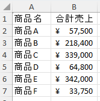

# vba-store-summary-automation

## 概要
- 店舗ごとに別シートで管理している売上データを、**商品別の合計売上**として「集計」シートへ自動転記する Excel マクロです。
- 店舗シートを見比べながらの手作業の集計・転記と、入力ミスの確認作業を1クリックで実現します。
- 入力ミスがあるとシート名・セル位置を一覧表示します。

> [!Note]
> 本リポジトリの Excel ファイル `store_sales_dummy.xlsm` のデータはすべて**ダミーデータ**です。実在の企業・団体とは一切関係ありません。

## 機能

| 機能 | 内容 | 実装 |
|---|---|---|
| 商品別売上集計 | 「集計」以外の全シートを対象に、商品ごとの合計売上（数量×単価）を算出 | `CCompany.SummarizeSalesByProduct`（Dictionary で商品名をキーに加算） |
| 集計結果の転記 | 「集計」シートへ商品名・合計売上を出力し、商品名の昇順に並べ替え、会計表示形式に整形 | 配列で一括書き込み → `Range.Sort` / `NumberFormatLocal` |
| 入力値チェック | 商品名（空欄・文字列以外）、数量・単価（空欄・数値以外・0以下）を検出し、シート名とセル位置を表示 | 標準モジュールでバリデーション、`Collection` にエラーを蓄積 |
| 集計シート未作成の検知 | 「集計」シートが無い場合にエラーメッセージを表示 | エラー番号 9 をエラーハンドラで判定 |
| 集計対象なしの検知 | 「集計」以外のシートが無い場合にエラーメッセージを表示 | `storeCount = 0` で判定 |
| 想定外エラーの通知 | エラー番号・内容・発生元・対象シート・対象セルを表示して停止 | `On Error GoTo` + `Select Case` |

## 実行結果


## 実行方法
1. ワークシート「集計」を作成する

   > [!WARNING]
   > シート名は必ず「集計」にしてください。異なる名前だと実行時にエラーが発生します。

2. 各店舗シートに売上データを入力する
   > A列：商品名 / B列：数量 / C列：単価、1行目は見出し

   > [!WARNING]
   > 商品名に数字を入れる、空欄にするなどの不正値があるとエラーになり、集計は行われません。

3. 「開発」タブを開き、Visual Basic をクリックする

   > [!TIP]
   > 「開発」タブが無い場合は、Excel のオプション → リボンのユーザー設定 → 「開発」にチェックを入れてください。

4. 標準モジュール内の `ProductSummary` をクリックし、実行する

## 動作環境・使用技術
> **動作環境**： Microsoft Excel Home and Business 2024 （マクロの有効化が必要）

| 技術 | 内容 | 目的 | 該当箇所 |
|---|---|---|---|
| [Xlflow](https://github.com/harumiWeb/xlflow) | VBA を VS Code 上で編集・管理するフレームワーク | VBA をテキストファイルとして管理し、Git でバージョン管理する | `src/` 配下全体 |
| クラス（`CCompany` / `CStore` / `CSale`） | 会社 → 店舗 → 売上の階層をオブジェクトで表現（コンポジション：クラスが他のクラスを部品として持つ構造） | データの構造と役割を分け、保守しやすくする | `src/classes/` |
| `Scripting.Dictionary` | 商品名をキーに合計売上を加算 | 同じ商品名の売上を重複なく集計する | `CCompany.SummarizeSalesByProduct` |
| `Collection` | 売上・店舗・エラーメッセージを蓄積 | 件数が不定のデータを順に保持する | `CStore.mSales` / `CCompany.mStores` / `ProductSummary` の `errList` |
| `On Error GoTo` / `Err.Raise` | `On Error GoTo` でエラーを受け取り、`Err.Raise` でクラス内の不正値を通知 | 想定外エラー・不正値を検知し、原因を表示して安全に停止する | `ProductSummary` の `Errhandler` / `CSale` の各 `Property Let` |
| 配列での一括読み書き | シートの範囲を配列に読み込み、集計結果も配列で一括書き込み | シートへのアクセス回数を減らし、処理を速くする | `ProductSummary`（`data` / `wsData`） |

## 設計意図
### 標準モジュールとクラスモジュールにバリデーションを2重設計
モジュール別で、役割を分担させるため以下の設計にしました。また、バリデーションは標準モジュールではユーザー向け、クラスでは開発者向けという位置づけという考えです。
####  標準モジュール
- 不正値がある該当ワークシート、セルの箇所をユーザーに知らせる
#### クラス
- 標準モジュール内のバリデーションを通過した際の最終防衛線。万が一不正値があった場合に開発者に知らせる（Err.Raiseにてどこで不正値が発生したか詳細に知らせる設計にしました）
### エラーハンドリング
- On Errorステートメントは本処理すべての範囲を指定し、想定外のエラーが発生した場合にラベル元にジャンプ（エラー番号・内容・発生元・対象シート・対象セルをmsgboxにて表示）する設計にしました。クラス内のバリデーションエラーもラベル元でジャンプ、msgboxにて表示する設計にしております。
### 不正値を知らせる設計について
- 不正値が複数存在する状況を想定しCollectionにてエラーメッセージを蓄積し、まとめて表示して停止させる設計にしております。
### ディレクトリ構成
```
store-summary-vba-automation
├── build
│   └── store_sales_dummy.xlsm  # Excelデータ（Claudeにて作成したダミーデータ）
├── image
│   └── result.png  # 実行結果画像ファイル
├── src
│   └── classes # クラスモジュール
│       ├── CComanpy.cls    # 店舗別のデータを総集計するクラス
│       ├── Csale.cls       # 売上データをまとめるクラス
│       └── Cstore.cls      # 売上データを店舗別に集計するクラス
└── modules
    └── Xlflow
        └── StoreSummary.bas    # メインプログラム（標準モジュール）
```
## store_sales_dummy.xlsmについて
すべて架空のデータであり、実際の企業や団体とは無関係です。